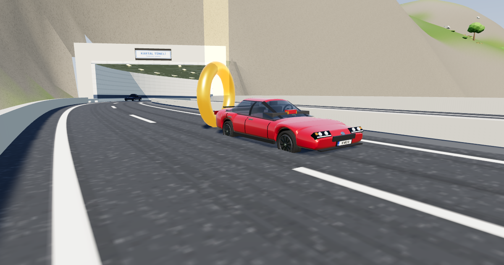

# Açık Yol

Tarayıcıda oynanan 3B araba oyunu. Şehir, beş otoyol, tüneller, kanyon viyadüğü, polisiyle taksisiyle kalabalık trafik,
çam ormanları ve çiçekli çayırlar, benzinlikler, rampalar,
altın jetonlar ve hayalet araçlı zaman yarışı.



## Nasıl oynanır

| Tuş | Ne yapar |
| --- | --- |
| `W` / `↑` | Gaz |
| `S` / `↓` | Fren, durunca geri vites |
| `A` `D` / `←` `→` | Direksiyon |
| `Boşluk` | El freni (drift) |
| `L` | Farlar |
| `N` | Gece / gündüz |
| `C` | Kamera |
| `R` | Devrilen aracı kaldır |
| `T` | Yarışı yeniden başlat |
| `M` | Ses |
| `Esc` | Garaj (menü) |
| `Enter` | Garajdayken sürmeye başla |

Oyun kolu ve telefon (dokunmatik direksiyon ve pedallar) da çalışır. Telefonda yatay tutmak en rahatıdır.

Garajda aracı oklarla, kartı parmakla yana kaydırarak ya da `←` `→` tuşlarıyla seçersin. **♪ Müzik** düğmesi açılış müziğini açıp kapatır.

**Modlar** (garajdan seçilir):

- **Serbest sürüş**: Işık sütunlarını takip edip jetonları topla.
- **Çevre Yolu Turu** ve **Dağ Otoyolu**: Kontrol kapılarından sırayla geç. Rekorunu kırınca o tur
  "hayalet araç" olarak kaydedilir; sonraki denemede kendi rekorunla yarışırsın.

İlerleme (araç, boya, jetonlar, rekorlar) tarayıcıda saklanır. Garajdaki **İlerlemeyi sıfırla** ile silinir.

## Bilgisayarda çalıştırmak

`index.html` dosyasına çift tıklamak yeterli. İnternet bağlantısı gerekir, çünkü 3B motor (three.js) ve yazı tipleri
internetten yüklenir.

## GitHub Pages ile yayınlamak

1. GitHub'da yeni bir depo (repository) aç, örneğin `Araba`.
2. Bu klasördeki her şeyi depoya yükle (`index.html`, `css/`, `js/`, `favicon.svg`, `onizleme.png`, `README.md`).
   `yedek/` klasöründe oyunun eski tek dosyalık hâli var; istersen yükleme.
3. Depoda **Settings → Pages** bölümüne git. **Source: Deploy from a branch**, **Branch: main**, klasör **/ (root)** seç ve kaydet.
4. Bir iki dakika sonra oyun `https://yusufalpuzunal.github.io/Araba/` adresinde açılır. Bu bağlantıyı arkadaşlarınla paylaş.

**Not:** WhatsApp gibi uygulamalarda bağlantının altında önizleme resmi görünsün diye `index.html` içinde sitenin tam
adresi yazılı. Depo adı ya da kullanıcı adı değişirse bu satırı da güncelle:

```html
<meta property="og:image" content="https://yusufalpuzunal.github.io/Araba/onizleme.png">
```

## Dosyalar

| Dosya | İçindekiler |
| --- | --- |
| `index.html` | Sayfa: gösterge, garaj menüsü, dokunmatik kontroller ve dosyaların yüklenme sırası |
| `css/style.css` | Görünüm (renkler, yerleşim, telefon düzeni) |
| `js/utils.js` | Matematik, rastgele sayı ve gürültü yardımcıları |
| `js/world-data.js` | Arazi, vadiler, yollar, **otoyollar** (`makeHighway`), tüneller, zemin sorgusu |
| `js/renderer.js` | 3B motor, gökyüzü, güneş |
| `js/textures.js` | Kanvasla çizilen dokular, tabelalar ve levhalar, ışık hâleleri, gömülü modelleri okuyan yardımcı |
| `js/city-props.js` | Sokak eşyaları (bank, çöp kutusu, saksı, yangın musluğu, durak, ATM, reklam panosu, yangın merdiveni ...) |
| `js/city-old.js` | Eski şehir mahallesinin tuğla binaları |
| `js/world.js` | Dünyayı kurar: binalar, eski şehir, kaldırım eşyaları, dükkanlar, lambalar, köprüler, tüneller, dere, ağaçlar, jetonlar, mini harita |
| `js/vegetation.js` | Bitki örtüsü: ağaç türleri (çam, ladin, meşe, kavak, huş), çalılar, kayalar, çimen ve çiçekler; rüzgârda salınım |
| `js/car-body.js` | Gerçekçi araç gövdesi: yan profilden yuvarlatılmış gövde, daralan cam kabin, tavan ve direkler, yere oturan gölge |
| `js/car-model.js` | **Araç listesi (`CARS`)**, boyalar (`PAINTS`) ve 3B araç modeli |
| `js/physics.js` | Araç fiziği: süspansiyon, lastik tutuşu, çarpışmalar |
| `js/traffic-cars.js` | Trafikteki arabalar, otobüs ve minibüs modelleri |
| `js/car-assets.js` | Trafikteki iş araçları: kamyonet, ambulans, itfaiye, çöp kamyonu |
| `js/traffic.js` | Trafik ağı ve trafikteki araçlar |
| `js/city-peds.js` | Yaya karakterleri (yürüme, koşma, bekleme animasyonlarıyla) |
| `js/peds.js` | Kaldırımda yürüyen yayalar: araç yaklaşınca kaçar, hiç ezilmez |
| `js/audio.js` | Motor, lastik, tünel yankısı, rüzgâr, metal çarpma sesi ve garajdaki açılış müziği (dosyasız, anında sentezlenir) |
| `js/input.js` | Klavye, dokunmatik ve oyun kolu |
| `js/race.js` | Zaman yarışı, kontrol kapıları, rekorlar, hayalet araç |
| `js/game.js` | Oyun döngüsü, kamera, gösterge, gece/gündüz, tünel ışığı, kayıt |

Dosyalar `index.html` içindeki sırayla yüklenir ve birbirlerinin değişkenlerini kullanır. Bu yüzden sıra önemlidir.

## Kendin bir şeyler eklemek

**Yeni araç:** `js/car-model.js` içindeki `CARS` listesine mevcut bir aracı kopyalayıp yapıştır, sonra
`name`, `plate`, `hp`, `tq` (tork) ve `mass` değerlerini değiştir. `grip` tutuşu, `steer` direksiyon açısını,
`down` yere basma kuvvetini belirler.

**Trafik:** `js/traffic.js` içindeki `BOT_TYPES` listesinde her türün yanındaki `n` o türden kaç araç dolaştığını belirler.
`q` (City Pack) ya da `m` (Kenney) hangi 3B modelin kullanılacağını, `L`/`W` aracın boyunu ve enini (metre) belirler.

**Yeni boya:** Aynı dosyadaki `PAINTS` listesine `["Adı", "#renkkodu"]` ekle.

**Yeni otoyol:** `js/world-data.js` içindeki `MT` (Dağ Otoyolu) iyi bir örnektir. `makeHighway` ile kontrol
noktaları verilir, yol arazinin altında kalınca kendiliğinden tünel, boşluk üstünden geçince köprü olur.
Ardından `HWYS` ve `ROADS` listelerine ekle, trafik için de `js/traffic.js` içindeki bağlantı listesine ekle.

Oyuncu araçlarının tasarımları, markalar ve dükkanlar bu oyun için uydurulmuştur.

## Teşekkür

Oyundaki hazır 3B modeller, aşağıdaki sanatçıların ücretsiz paylaştığı çalışmalardır. Modeller oyunun içine
gömülürken küçültüldü, ölçeklendi ve bazılarının rengi değiştirildi.

**Kamu malı (CC0 1.0), özgürce kullanılabilir:**

- [Quaternius](https://quaternius.com): trafikteki arabalar (sedan, hatchback, iki spor araba, SUV, polis, pikap),
  büyük eski bina, çöp konteyneri ve yaya karakterleri (erkek, iki kadın)
- [Kenney](https://www.kenney.nl) Car Kit: kamyonet, ambulans, itfaiye, çöp kamyonu

**Yazar adı belirtilerek kullanılabilir ([CC-BY 3.0](https://creativecommons.org/licenses/by/3.0/)):**

- J-Toastie: eski şehir binaları (kırmızı, yeşil, kahverengi, köşe binası, pizzacı), posta kutusu, rögar kapağı,
  yangın merdiveni, çatı çıkışı, ATM, elektrik panosu, çiçeklik
- Poly by Google: yangın musluğu, bisiklet, reklam panosu, otobüs, minibüs
- Zsky: saksılar, çöp kutusu, otobüs durağı
- dook: otobüs durağı tabelası
- Danni Bittman: bank
- Jens Kull: çöp poşeti

Modellerin çoğu Poly Pizza'daki [City Pack](https://poly.pizza/bundle/City-Pack-kJqRAIGsw0) paketinden alınmıştır.
